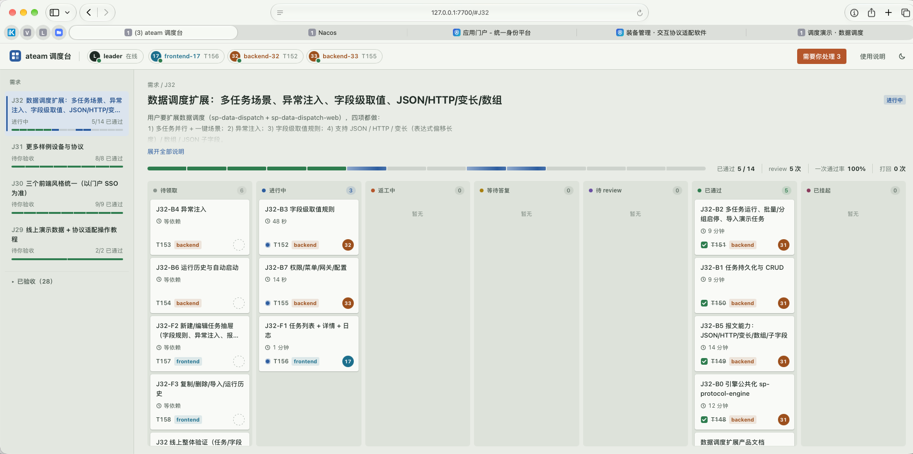

# agent-team（ateam）

让 Claude Code 当 leader，带几个 worker，在同一个项目里分工写代码。

- 你只和 leader 说话：提需求 → leader 拆成任务派给 worker → worker 写代码、提交 → leader review，不合格就打回 → 全部通过后 leader 向你汇报 → 你验收。
- worker 的 token 用完、窗口停了也没关系：你换个账号开新窗口，新 worker 会接着上一个的改动继续做。
- 浏览器里有一个看板，随时能看每个任务做到哪了、review 了几轮。

需要 Node ≥ 18 和 git，没有其他依赖。



## 名词

**角色与身份**

| 名词 | 含义 |
|---|---|
| agent | 一个 AI 编程程序的窗口。目前 leader 用 Claude Code，worker 用 WorkBuddy；也可以换成别的，只要能运行 shell 命令、能加载 skill |
| leader | 带团队的那个 agent（Claude Code，加载 `ateam-lead` skill）。你只和它对话：它拆任务、派任务、review、回答提问、写汇报 |
| worker | 干活的 agent（加载 `ateam-worker` skill）。领任务、写代码、提交。一个 worker 就是一个 agent 窗口，同一时间只做一个任务 |
| 角色 | worker 的工作分类，比如 frontend、backend、test。任务只派给同角色的 worker。按「做什么活」起名，不要按窗口起名 |
| 编号 | worker 加入时服务分配的唯一身份，比如 `frontend-2`（角色 + 序号。序号按角色递增，不会分给别的窗口；同一个窗口掉线后用原编号重新加入，编号不变）。worker 的每条命令都带 `--as <编号>` |
| 名字 | 可选的好记名称，比如「账号A」，加入时用 `--name` 指定，只用于显示；身份仍以编号为准 |

**工作单位**

| 名词 | 含义 |
|---|---|
| 需求 | 你提的一件事，编号 `J1`、`J2`……leader 把它拆成若干任务 |
| 任务 | 一个 worker 一次能做完的活，编号 `T1`、`T2`……包含角色、允许改动的路径、描述、验收标准、依赖 |
| 允许改动的路径 | 任务里写明的目录或文件（`--paths`）。提交时只提交这些路径里的改动，路径外的改动不会被提交 |
| 依赖 | 任务 A 依赖任务 B：B 通过之后 A 才能被领取 |
| 验收标准 | leader review 时逐条核对的条目 |
| 项目目录 | 运行 `ateam serve` 的目录，也就是要开发的项目。任务路径都相对于这里。它本身是 git 仓库，或者下面一层有几个 git 仓库（多仓库项目） |

**任务流程**

| 名词 | 含义 |
|---|---|
| 领取 | worker 调用 `ateam wait` 时，服务把一个能做的任务派给它 |
| 提交 | worker 做完后运行 `ateam submit`，服务替它 `git commit` 任务路径里的改动 |
| review | leader 检查提交：通过，或者打回 |
| 打回 | review 不通过，修改意见送回给原 worker 重做 |
| 挂起 | 同一个任务被打回 3 次，停止自动派发，等 leader 改写任务或自己动手 |
| 作废 | 不再需要的任务（`ateam cancel`）。不再派发、不计入进度，看板上置灰放在最下面 |
| 汇报 | 需求的所有任务都通过后，leader 写给你的总结；需求进入「待你验收」，你测过后点「验收通过」变成「已验收」 |

**在线与掉线**

| 名词 | 含义 |
|---|---|
| 心跳 | 服务判断 worker 还活着的依据：worker 调用任何 `ateam` 命令，或者它任务路径里的文件在变 |
| 租约 | 多久没有心跳算「可能停了」，默认 15 分钟 |
| 掉线 | 空闲的 worker 超过租约没有心跳就算掉线；手上有任务的，要你确认窗口没了才算（见「worker 可能停了、换人接手」）。回来时用原编号重新加入 |
| 接手 | 新 worker 领到上一个 worker 留下的任务，收到「⚠ 接手任务」，在已有改动上继续，不从头做起 |
| 下线 | leader 或你主动让 worker 收工（看板「使用说明」面板里的「全部下线」「下线」，或 `ateam dismiss`）。可以立即停止（进行中的任务退回待领取，已有改动保留），也可以做完手上的任务再走。和「掉线」不同，下线是正常结束 |
| 收回 | 确认原窗口没了时，立即把任务从它手上拿回来交给别人接手，不必等租约过期（看板上的「收回任务」或 `ateam reclaim`） |
| 叫醒话 | worker 窗口还在但停住了不动时，发给它让它继续的那句话。点看板顶部的 worker 标签就能复制 |

**工具**

| 名词 | 含义 |
|---|---|
| 服务 | `ateam serve` 启动的本地程序，保存所有状态，负责派发、计时、提交。只监听本机 |
| 看板 | 浏览器打开 <http://127.0.0.1:7700> 看到的页面，每 3 秒刷新 |
| skill | 教 agent 怎么当 leader 或 worker 的说明文件（`SKILL.md`）。`ateam-lead` 给 leader，`ateam-worker` 给 worker |
| 提示词 | 你发给 agent 窗口的那句话，比如「使用 ateam-worker skill，角色 frontend」。点看板右上角「使用说明」，leader 和 worker 的提示词都按步骤列在里面，可以直接复制 |

---

## 一、安装（只做一次）

> 服务跑起来以后，看板右上角「使用说明」→「安装」页里也有这些步骤，命令里的路径已经填好，可以直接复制。

### 1. 注册 `ateam` 命令

```bash
cd ~/code/agent-team
npm link
ateam help          # 能打印出命令列表就成功了
```

如果提示找不到 `ateam`，说明 npm 的全局目录不在 PATH 里。运行下面这行把它加进 `~/.zshrc`，然后开一个新终端再试：

```bash
echo "export PATH=\"$(npm prefix -g)/bin:\$PATH\"" >> ~/.zshrc
```

### 2. 安装两份 skill

两份 skill 分给两个程序用，**两边各放一份**：

| skill | 给谁用 | 放到哪里 |
|---|---|---|
| [skills/ateam-lead/SKILL.md](skills/ateam-lead/SKILL.md) | Claude Code（leader） | `~/.claude/skills/ateam-lead/SKILL.md` |
| [skills/ateam-worker/SKILL.md](skills/ateam-worker/SKILL.md) | WorkBuddy（worker） | `~/.workbuddy/skills/ateam-worker/SKILL.md` |

用软链安装，以后 agent-team 更新了，skill 自动就是新的：

```bash
mkdir -p ~/.claude/skills ~/.workbuddy/skills
ln -s ~/code/agent-team/skills/ateam-lead   ~/.claude/skills/ateam-lead
ln -s ~/code/agent-team/skills/ateam-worker ~/.workbuddy/skills/ateam-worker
```

检查：`ls -l ~/.claude/skills/` 里 `ateam-lead -> .../agent-team/skills/ateam-lead` 这样带箭头的就是软链。

---

## 二、每次开工

下面以要开发的项目 `~/code/apiloop` 为例。

### 1. 在**要开发的项目根目录**启动服务

```bash
cd ~/code/apiloop          # ⚠ 一定是要开发的项目，不是 agent-team
ateam serve
```

看到这两行就对了：

```
ateam 服务已启动：http://127.0.0.1:7700（看板同地址）
项目目录：/Users/kana/code/apiloop（任务路径相对于这里，worker 的改动必须在这个目录里）
```

- **「项目目录」必须是你要开发的项目。** worker 提交时，服务只在这个目录里找改动；目录不对，worker 提交会一直报「没有改动」。
- 这个终端窗口**一直开着**，关掉服务就停了。
- 项目必须是 git 仓库（没有就先 `git init`），或者下面一层有 git 仓库（见下面「多仓库项目」）。worker 不自己提交，由服务在仓库里替它提交、并且只提交任务允许改动的路径，所以离不开 git。
- 服务会在项目里建 `.ateam/` 存状态，并把 `.ateam/` 加进 `.gitignore`（这个改动需要你自己提交）。重启服务状态不丢。

**多仓库项目**：比如前后端是两个仓库，放在同一个上级目录下：

```
myapp/   ← 在这里运行 ateam serve（它本身不是仓库也行）
├── web/   ← git 仓库
└── api/   ← git 仓库
```

启动时会多显示一行「多仓库模式，包含 git 仓库：api、web」。之后：
- 任务路径写成「仓库目录/子路径」，比如 `api/`、`web/src/`。leader 会按这个写。
- 提交时服务自动找到路径所属的仓库，在那个仓库里提交；提交号显示成 `api@a1b2c3d`。一个任务跨两个仓库时，两边各提交一次。
- `.ateam/` 建在 `myapp/` 下；`myapp/` 不是仓库，所以不改任何 `.gitignore`。

### 2. 打开看板

浏览器打开 <http://127.0.0.1:7700>（只能用 `127.0.0.1` 或 `localhost`）。

### 3. 开 leader

在**同一个项目目录**开一个 Claude Code 会话，说：

```
使用 ateam-lead skill，作为 leader 加入这个项目的团队
```

它会先看一下现状（在线的 worker、没做完的需求），然后等你。接着在对话里跟它说需求就行，比如「需求是……」。leader 拆完任务会告诉你需要开几个什么角色的 worker，按下一步去开。之后它自己派发、review，全部完成后在对话里给你汇报。

上下文满了、重开 leader 会话时，也发同一句话：它会先接着处理没做完的事。

leader 在线时，看板顶部最前面是绿点「leader 在线」。

### 4. 开 worker

按 leader 说的角色和数量开 WorkBuddy 窗口，**工作目录选同一个项目**，分别对它们说：

```
使用 ateam-worker skill，角色 backend
使用 ateam-worker skill，角色 frontend
```

同一个角色可以开多个窗口。想区分它们，就在后面加个名字，看板和 `ateam status` 上会显示「账号A（frontend-2）」：

```
使用 ateam-worker skill，角色 frontend，名字 账号A
使用 ateam-worker skill，角色 frontend，名字 账号B
```

**角色就是工作分类**，比如 frontend、backend、test。派发不是随机的：分类为 backend 的任务只会派给以 backend 加入的 worker。所以角色要按「做什么活」起名，不要按窗口起名（像 session1、session2 这种，leader 只能把前后端的活混着派）。同一分类可以开多个 worker，它们会按顺序分着领。

worker 加入后看板顶部会出现绿点。每个分类有固定颜色，卡片上的分类标签同色，一眼能分清谁做什么。

> 记不住这些话也没关系：服务启动后，点看板右上角「使用说明」，leader 和 worker 该发的话都按顺序列在里面，带项目目录，点「复制」就行。

---

## 三、看板怎么看

对照开头的截图：

- **顶部左边**：最前面是 leader 的连接状态（绿点在线，红点未连接），后面每个在线 worker 一个标签：编号、角色（每个角色固定一种颜色）、当前任务。掉线的 worker 收成一个灰色的「N 个已掉线」。
  - 点 leader 标签：打开 leader 的加入提示词。
  - 点 worker 标签：打开它的叫醒话和「安排下线」。
  - 点「N 个已掉线」：可以重连或移除。
- **浏览器通知**：顶部点一次「开启通知」，浏览器问是否允许时选允许。之后同样这些事持续 1 分钟以上就弹一条通知（同一件事只弹一次，没有声音），点通知回到看板。看板标签页要开着，放在后台也行。按钮不见了说明已经允许或已经拒绝；拒绝过的要到浏览器的网站设置里改回允许。
- **项目规则**：「使用说明」里的「项目规则」页，写每个任务都要遵守的约定（比如不写测试、提交前跑哪条编译命令）。worker 领到任务时自动附在任务后面，leader 不用每个任务重复写；改完保存，之后派发的任务马上生效。
- **顶部右边**：有事需要你处理时，先出现一个红框按钮「需要你处理 N」（需求待验收、某个角色缺 worker、有活干时 leader 没连上），鼠标停在上面能看到是哪几件，点它跳到第一件。同时浏览器标签页标题前面显示「(N)」，图标右上角出现红点，看板不在前台也能注意到；服务连不上时显示「(!)」。再往右是「使用说明」，分 worker / leader / 安装 / 项目规则四页，开 worker、开 leader、安装要发的话和命令都在里面，点「复制」就行。
- **左边**：需求列表，新的在上面。彩色条每一格是一个任务，颜色就是它的状态，后面是已通过数。已验收的需求收在最下面的「已验收（N）」里，点一下展开或收起。
- **中间上方**：需求标题、说明、进度条和 review 统计（review 次数、一次通过率、打回次数）。
- **中间**：选中需求的任务看板，按状态分 7 列：

  | 列 | 含义 |
  |---|---|
  | 待领取 | 等 worker 来领；带「接手」标记的是上一个 worker 掉线留下的 |
  | 进行中 | worker 正在做 |
  | 返工中 | 被打回过，worker 在改 |
  | 等待答复 | worker 提了问题，等 leader 回答 |
  | 待 review | worker 已提交，等 leader 审 |
  | 已通过 | 完成 |
  | 已挂起 | 打回 3 次还不行，等 leader 处理 |

  作废的任务不在这 7 列里，置灰放在看板最下面。「待领取」一列按派发顺序排，带红色「优先」标记的排在最上面，会被先领走。

- **点卡片**：右边弹出详情（验收标准、描述、提交记录、完整时间线）。右上角「←」展开到大半屏；点抽屉外任意地方、点「关闭」或按 Esc 关闭；点另一张卡片直接切换。进行中的任务在这里可以「收回任务」；待领取的任务可以「设为优先」，同角色的 worker 下一个先领它。
- **汇报**：需求全部完成后，需求顶部出现「查看汇报」，点开是单独的阅读页。
- 页面每 3 秒自动刷新。

---

## 四、常见情况

### worker 等了一会儿就自己停了

worker 应该一直循环等任务。如果它停下来问你「要继续等吗」，或者交完一个任务就停了：点看板顶部它的标签，把「叫醒话」复制到它自己的窗口里（直接说「继续」通常也行）。

### worker 可能停了、换人接手

以下都算 worker 有动静：调用 `ateam` 命令，或者任务路径里的文件在变。worker 要跑很长的命令（导入数据、全量构建）前，会用 `ateam progress ... --expect 30` 报备预计时长，这段时间也算有动静。

**手上有任务的 worker 超过 15 分钟没动静**：任务**不会**自动交给别人。看板会弹出确认框（同时标题出现数字、弹浏览器通知），leader 也会来问你。去它的 agent 窗口看一眼，然后：
- **还在干活**（比如在跑很长的命令）：点「还在干活，继续等」，再过 15 分钟没动静才会再问。
- **窗口停住了，但还在**：不用换人，把框里的叫醒话发到那个窗口。它一有动静，提醒自动消失。
- **窗口没了**（关了、token 用完了）：点「窗口没了，换人接手」。任务退回待领取，同角色的空闲 worker 以「⚠ 接手任务」领走，在已有改动上继续。没有空闲的 worker 就换个账号开新窗口。
- 暂时不想处理：点「稍后再说」。

不想等 15 分钟也可以：在看板上点开它的任务卡片，在「原窗口没了？」下点「收回任务」（或者让 leader 运行 `ateam reclaim T3`）。

**空闲的 worker 超过 15 分钟没动静**：直接算掉线，没有任务需要转手。点看板顶部「N 个已掉线」，把「重连」话发到它的窗口即可。

**原 worker 其实还活着**：它下次调用命令时会收到提示，然后用原编号重新加入。如果它的任务还没人领走，会还给它；已经被别人接手的话，它会被明确告知不要再改那个任务的文件。

### 作废了一个 worker 正在做的任务

worker 正在干活时没法被打断，要等它下一次调用 ateam 命令（一般几分钟内）才会收到作废通知，然后停手、把改动收进 `git stash`。在那之前，看板「需要你处理」里会出现「xx 还在做已作废的 T5」，标题出现数字、弹浏览器通知。想让它马上停：点「需要你处理」，打开它的卡片，在它的 WorkBuddy 窗口里点停止，把卡片上那句叫停的话发过去。作废任务的详情里也有这句话。

### worker 提交时报「指定路径下没有改动」

先看错误信息里的「服务的项目目录」：

- **不是你要开发的项目**：服务起错了目录。按下面「服务起错了目录」处理，worker 的改动不要动。
- **是对的**：说明 worker 确实没在允许的路径里改文件，让 leader 看一下。

### 服务起错了目录

```bash
# 1. 在服务窗口按 Ctrl+C 停掉
# 2. 把状态搬到正确的项目（假设之前错起在 ~/code/agent-team）
mkdir -p ~/code/apiloop/.ateam
cp ~/code/agent-team/.ateam/state.json ~/code/apiloop/.ateam/
# 3. 在正确的目录重新启动，确认「项目目录」那一行
cd ~/code/apiloop && ateam serve
# 4. 对卡住的 worker 说「服务已重启，继续」
# 5. 确认没问题后删掉旧状态
rm -r ~/code/agent-team/.ateam
```

整个过程尽量在 1 分钟内完成：服务断开超过约 60 秒，worker 会收到「服务不可达」并停下。如果停了，对它说「继续」即可。

### 验收需求

需求的任务全部通过后，leader 提交汇报，需求变成「待你验收」。打开这个需求，点「查看汇报」看 leader 做了什么、让你重点测什么，然后自己测：
- **没问题**：点「验收通过」，再点「确认验收通过」（汇报页顶部也有这个按钮）。需求在左侧列表里标成绿色的「✓ 已验收」。也可以直接对 leader 说「J3 验收通过」。
- **有问题**：在对话里告诉 leader 哪里不对。它会在这个需求下加修复任务，需求回到「进行中」，修完再给你汇报一次。

### 活都干完了，让 worker 收工

worker 没活时会一直挂着等任务。空闲超过 3 分钟（本角色没有待领取的任务）时，它会自动向 leader 申请下线，看板上它的卡片标着「申请下线」，leader 决定要不要让它走。**每个角色至少留一个 worker**：最后一个要下线，需要 leader 和你都同意（leader 会先问你；你在看板上点它的「下线」也要再点一次「确认下线」）。空闲多久算久可以用 `ateam serve --idle <分钟>` 调。

手上有任务的 worker，在看板上点「下线」会让你选：「做完 T39 再下线」（做完这个任务、review 通过后才走，期间不领新任务，打回也由它自己改）或「立即下线」（马上停，进行中的任务退回待领取）。选了做完再下线的，卡片标着「做完下线」，还可以「撤销」。命令行是 `ateam dismiss <编号> --after-task`。

所有需求做完后：点看板右上角「使用说明」→「worker」页里的「全部下线」，或者对 leader 说「让大家收工」。worker 立即停下；进行中的任务退回待领取。之后要再开工，重新开 worker 窗口即可。

### leader 会话重开了（上下文满了）

在新会话里发看板「使用说明」→「leader」里的那句加入的话（或者说「使用 ateam-lead skill，继续」）。它会先运行 `ateam status`，从「待你处理」列表接着做。

### 更新了 agent-team 的代码之后

- 改了服务端代码（`src/` 下的 `.js` 文件）：重启 `ateam serve`。状态不会丢，worker 和 leader 会在约 60 秒内自动重连。忘了也没关系：服务发现代码比自己新时，看板顶部会出现黄色提示条「服务还在跑旧代码」，`ateam status` 也会提醒 leader。
- 改了命令行（`bin/ateam.js`、`src/format.js` 的输出文字）：下一条命令就生效；`src/format.js` 有一部分输出由服务生成，稳妥起见也重启一下服务。
- 只改了看板（`src/dashboard.html`）：刷新浏览器即可。
- 改了 skill：软链安装，自动生效；agent 窗口要新开才会读到新 skill。

**看板上的新功能不生效、或者显示不对**（比如 leader 明明在线却显示「未连接」）：多半是看板已经是新的，服务还是旧的。重启 `ateam serve` 再刷新。

---

## 五、参数与环境变量

| 设置 | 说明 | 默认 |
|---|---|---|
| `ateam serve --port 7701` | 换端口（7700 被占用时） | `7700` |
| `ATEAM_URL` | 换了端口后，leader 和 worker 都要设置，例如 `http://127.0.0.1:7701` | `http://127.0.0.1:7700` |
| `ateam serve --lease 5` 或 `ATEAM_LEASE_MIN` | 租约时长（分钟）：多久没动静算「可能停了」（手上有任务的弹框问你，空闲的直接算掉线）。正常干活用默认值 | `15` |
| `ateam serve --idle 5` 或 `ATEAM_IDLE_MIN` | 空闲多久（分钟）后 worker 自动向 leader 申请下线 | `3` |

## 六、命令速查

一般不用你手动敲命令，leader 和 worker 会自己调用。需要排查时可以用：

```bash
ateam status        # 全局概况：项目目录、待处理事项、worker、各任务状态
ateam show T3       # 某个任务的详情和完整历史
ateam cancel T3 "原因"   # 作废任务：不再派发，看板上置灰放到最下面
ateam reclaim T3         # 原窗口没了：立即收回任务，交给同角色的 worker 接手
ateam job edit J1 --desc-file job.md   # 改需求的说明（或 --title 改标题）
ateam job accept J1 J2   # 验收通过（看板上点「验收通过」也一样）
ateam task top T5        # 设为优先：同角色的 worker 下一个先领它（--off 取消；看板上点开待领取的任务也能设）
ateam rules              # 查看项目规则；ateam rules add "提交前先跑一遍编译" 加一条（看板「使用说明 → 项目规则」也能改）
ateam jobs --grep 公告    # 翻看已验收的历史需求（--all 包括没验收的）；ateam job show J13 看单个需求的任务、提交和汇报
ateam task edit T3 --role backend      # 改任务的角色（待领取或已挂起的任务）
ateam dismiss --all --user-approved   # 活干完了，让 worker 全部下线（也可以 --role frontend 或指定编号；让某个角色一个不剩时要加 --user-approved，表示用户同意）
ateam help          # 全部命令
```

设计细节见 [docs/superpowers/specs/2026-10-03-agent-team-design.md](docs/superpowers/specs/2026-10-03-agent-team-design.md)。
